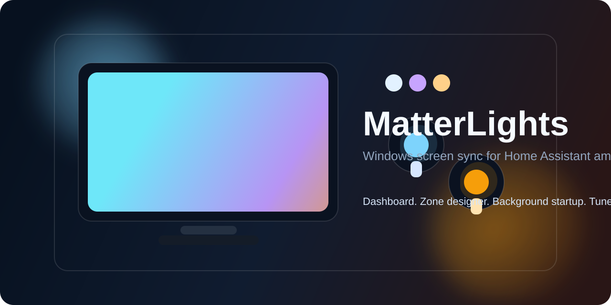
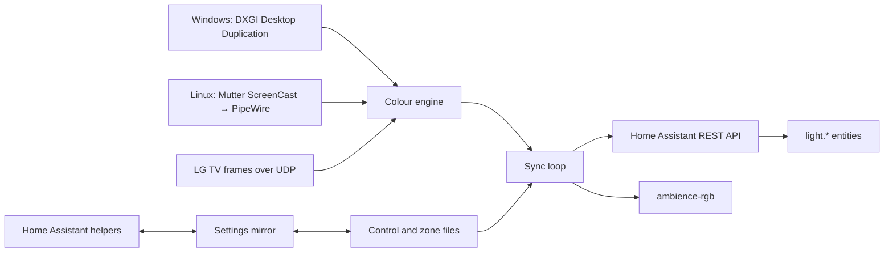

# MatterLights

[](https://www.microsoft.com/windows)
[](https://www.kernel.org/)
[](https://www.python.org/)
[](https://www.home-assistant.io/)
[](LICENSE)

MatterLights samples your screen and sends a matching colour to Home Assistant lights in near real time — ambient
lighting for a gaming or media PC, on **Windows and Linux (GNOME Wayland)**. It talks to the `light.*` entities you
already have (Matter bulbs, in my case), so there is no extra lighting server or streaming stack.

## Features

- **Ambience engine** — renders the screen's overall light as a small weighted palette spread across the bulbs beside
  the screen and the ones deeper in the room, instead of painting the whole room the strongest colour on screen. The
  older zoned and shared-variant engines are still there.
- **Saved colour or pattern** — play a static colour, a tunable white or a looping multi-colour pattern instead of
  following the screen.
- **Everything controlled from Home Assistant** — the master switches, the mode, the capture screen, the saved
  colour and pattern, the engine, the zones, a restart button and a live status sensor.
- **Gets out of the way** — lights off when the screen goes dark, when the monitor sleeps and at shutdown; a heartbeat
  lets Home Assistant turn them off if the PC crashes or loses power.
- **Two sources, one set of bulbs** — a second instance can drive the same lights from another source (an LG TV), and
  a selector in Home Assistant decides which one owns them. A manual-control switch makes every instance stand aside.
- **Case lighting** — optionally publishes each frame's colours to [ambience-rgb](https://github.com/Jxn01/ambience-rgb),
  which drives the RGB hardware inside the PC.
- **Runs unattended** — autostart on both systems, single-instance lock, no console windows, Home Assistant writes
  kept off the capture loop.

## How it works



Capture hands BGRx bytes to one platform-free colour engine, so every colour decision is identical on both systems.
On Windows it uses DXGI Desktop Duplication (with a GDI fallback); on Linux, GNOME's ScreenCast API over PipeWire,
read through GStreamer, with the xdg-desktop-portal as a fallback (where the user picks the screen in a dialog).

## Install

### Linux (GNOME Wayland)

```bash
# Arch
sudo pacman -S --needed python-gobject gstreamer gst-plugins-base gst-plugin-pipewire
# Debian / Ubuntu
sudo apt install python3-gi gstreamer1.0-pipewire gstreamer1.0-plugins-base

scripts/linux/install.sh
```

PyGObject and GStreamer come from the distribution, not pip, so the virtualenv must be created from the system Python
(the installer refuses a conda interpreter for that reason). The installer creates it at
`~/.local/share/venvs/matterlights`, writes `.env` from `.env.example`, checks Home Assistant, and offers two systemd
units: `matterlights-sync` (a user unit tied to the graphical session) and `matterlights-lights-off` (a system unit that
turns the lights off at shutdown). Put your token in `.env` and run it again.

### Windows

```powershell
powershell -ExecutionPolicy Bypass -File .\scripts\guided-setup.ps1
```

It creates `.venv`, installs the package, asks for your Home Assistant token, lists your `light.*` entities to choose
from, writes `.env`, and can install the logon task (`scripts\install-autostart.ps1`), which runs the sync loop with
`pythonw.exe` so no console window appears.

To turn the lights off at shutdown and restart, also install the shutdown task once, from an **elevated** PowerShell.
It runs as SYSTEM on System event 1074 — an in-process hook alone is not reliable there, because the process is torn
down before its window sees `WM_ENDSESSION`:

```powershell
powershell -ExecutionPolicy Bypass -File .\scripts\install-shutdown-task.ps1           # -Remove to uninstall
Start-ScheduledTask -TaskName 'MatterLights Lights Off At Shutdown'                     # test it without rebooting
```

## Home Assistant

Every setting lives in Home Assistant helpers, mirrored both ways with the running loop. Each one is optional; set its
entity in `.env`:

| Helper | Setting | What it does |
| --- | --- | --- |
| `input_boolean` ×2 | `HA_LIGHTS_SWITCH_ENTITY`, `HA_RGB_SWITCH_ENTITY` | master switches for the bulbs and for the case lighting |
| `input_boolean` | `HA_MANUAL_ENTITY` | while on, no instance touches the bulbs, so a colour set by hand stays |
| `input_select` | `HA_MODE_ENTITY` | *Follow the screen*, *Saved colour* or *Saved pattern* |
| `input_select` | `HA_SCREEN_ENTITY` | which screen to capture; the running machine writes the options (its monitors) |
| sensor | `HA_STATUS_ENTITY` | what the loop is doing, with the engine, the bulbs that answer and recent problems |
| helpers named `<prefix>_*` | `HA_HUB_PREFIX` | saved colour, white, brightness and pattern, the colour engine, one zone per bulb, a restart button |

A pattern is typed as one line: steps separated by commas, each a colour (`#rrggbb` or a white like `2700K`), a hold in
seconds and an optional fade-in — `#ff0000 3, #0000ff 4 1, #ffff00 0 2` is a 10-second loop. A value that cannot be
applied stays in Home Assistant as typed and is reported on the status sensor until it is corrected.

Shared helpers follow one rule: on the first reading Home Assistant wins (so either half of a dual-boot machine picks
up where the other left off); after that, whichever side changed is copied to the other. The screen select is the
exception — monitor numbers belong to one OS, so the running machine wins.

**Safety net.** The loop refreshes `sensor.matterlights_heartbeat` with a timestamp every 30 seconds. An automation
turns the lights off once it is three minutes old, which covers a crash, a reset or a power cut:

```yaml
alias: MatterLights - lights off when the PC stops reporting
mode: single
trigger:
  - platform: template
    value_template: >
      
      false
      {{ (now() - (raw | as_datetime)).total_seconds() > 180 }}
condition:
  - condition: state            # an instance standing aside stops its heartbeat
    entity_id: input_boolean.lamps_manual
    state: "off"
action:
  - service: light.turn_off
    target:
      entity_id: <your HA_LIGHT_ENTITIES>
```

## Two machines, one set of bulbs

Two loops driving the same bulbs is a strobe, so `HA_OWNER_ENTITY` names a selector in Home Assistant and
`HA_OWNER_VALUE` the value that means this instance. An instance that is not the owner leaves the bulbs completely
alone — no colours, no lights-off, no heartbeat. Taking over waits for a second reading, so the old owner's last colour
cannot land on top of the new owner's first.

`CAPTURE_SOURCE=tv` replaces the screen with 64×36 frames sent over UDP by a companion app on a rooted LG TV. Frames
are followed like a screen; a "protected" flag (DRM-protected video) gives a steady warm glow; idle or no frames for six
seconds turns the lights off.

## Configuration

Every setting, the per-OS overlays and the zone names are in [docs/configuration.md](docs/configuration.md). The most
important ones: `HA_URL`, `HA_TOKEN`, `HA_LIGHT_ENTITIES`, `COLOR_SYNC_MODE` (`ambience` recommended) and
`AMBIENCE_NEAR_LIGHTS` (the bulbs beside the screen).

Many Matter bulbs lock up when sent a `transition`, so fades are off by default (`MAX_PATTERN_TRANSITION_SECONDS=0`).

## Development

```bash
VENV=~/.local/share/venvs/matterlights
/usr/bin/python3 -m venv --system-site-packages "$VENV"
"$VENV/bin/python" -m pip install -e .
"$VENV/bin/python" -m unittest discover -s tests
scripts/linux/test-under-wine.sh          # the same suite on Windows CPython under Wine
```

On Windows: `.\.venv\Scripts\python.exe -m unittest discover -s tests`. Platform-specific tests skip on the other
system, and `tests/test_import_surface.py` imports every module on the current platform, so a platform-specific
import at module scope fails the build.

```text
src/matterlights/
  capture/            screen capture: Windows (DXGI/GDI), Linux (PipeWire via Mutter or the portal), the TV source
  display_power/      screen-sleep detection, per platform
  shutdown_hook/      session-end detection, per platform
  screen.py           the colour and zone engine (platform-free)
  ambience.py         the ambience engine
  ha_switches.py      the master switches, mirrored with Home Assistant
  ha_selects.py       the mode and screen selects, and the status sensor
  ha_hub.py           the other settings as Home Assistant helpers
  owner.py            which instance drives the bulbs; manual control
scripts/              Windows setup and autostart; scripts/linux: installer, Wine test runner
systemd/              unit files
```

## License

MIT — see [LICENSE](LICENSE).
